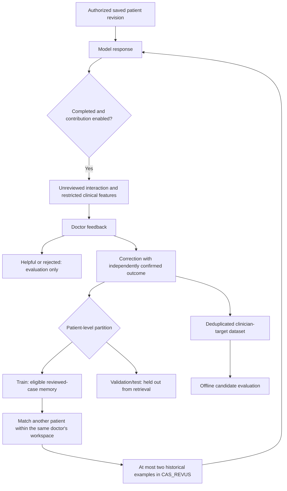

# Continuous learning from reviewed clinical cases

The app now captures eligible AI interactions and uses clinician-confirmed corrections to supplement future prompts. This updates the app's retrieval memory. It does not modify the external model's weights, start a paid training job, or establish that diagnostic accuracy has improved.

**Using the feature**

1. Enable the existing contribution preference in Settings. Its existing full-record archive still copies complete dossiers to MongoDB; the new reviewed-case memory is a separate collection with a restricted feature projection.
2. Request a new analysis or question response. Successful, completed patient-bound responses are captured automatically while contribution is enabled.
3. Use the feedback card below the response. “Utile” and “Réponse incorrecte” record evaluation feedback only. To create a learning case, enter the clinical conclusion, your corrected response, and the independent clinical evidence or subsequent outcome supporting it.
4. Choose confirmed only after the clinical outcome is established and explicitly confirm the review. Pending conclusions remain outside retrieval memory.
5. Future comparable cases may receive up to two relevant confirmed examples. Some patients' cases are reserved for validation/test and never enter retrieval memory.

The most recent reviewable analysis and question remain accessible through their saved history metadata, including after the dossier has been edited. Feedback is bound to the original server generation and revision. It cannot create an arbitrary new generation or attach another doctor's response to a case.



**What is and is not learned**

The learner extracts a fixed allowlist of normalized measurements, recorded yes/no facts, controlled categories, and age bands. A small clinical vocabulary can represent mentions in selected physician-entered notes without retaining those raw notes as features. Mention values distinguish positive wording, explicit negation, and conflicting wording; these are retrieval cues, not diagnoses or validated natural-language understanding.

Known patient identifiers and common email/date/number patterns are removed from stored response/question/correction text. Case identity is an HMAC scoped to the owning doctor. This is pseudonymization, not guaranteed anonymization: clinicians must remove identifiers from their corrections, and free text can still contain unrecognized identifying information.

Model responses are stored as unreviewed trace data. They are never automatically promoted to clinical truth and are never dataset targets. An accepted/helpful rating is also insufficient to create a learning case. Targets come only from the clinician-authored correction, confirmed conclusion, and rationale.

The pre-existing full-record archive remains separate and unreviewed. It is not searched by this learner and is not a source of automatically accepted labels. Do not treat its old model replies as supervised ground truth.

**Retrieval constraints**

- Contribution must still be enabled in the current consent/identity-key epoch.
- The case must belong to the authenticated doctor's workspace and to the train partition.
- The clinician must have supplied a confirmed correction with an explicit attestation.
- The current patient's cases are excluded, including older revisions, so their later outcome cannot be fed back into their own diagnosis as a similar historical case.
- Specialty must match; incompatible known pregnancy/safety facts and gestations more than two weeks apart are excluded.
- The initial similarity heuristic requires at least three clinical dimensions, at least 80% weighted agreement, and numerical matches within a 12% tolerance or a small absolute tolerance. This is an engineering retrieval heuristic requiring calibration; it is not a clinical probability or validated matching model.
- Candidate scans are bounded to the 200 most recent confirmed train records. Duplicate patients/feature profiles are removed and conflicting confirmed labels for identical feature profiles are excluded from the scanned candidates.
- At most two examples are included. Their outcomes and rationale are historical data, not current-patient facts or medical references. They cannot supply citation IDs. The existing medical-evidence citation checks remain in place.

**Data, endpoints, and provenance**

The `ai_reviewed_learning` collection stores the source revision, model/provider/prompt/corpus versions, original output, restricted features, consent epoch, partition, and review state. Each generated interaction records the IDs of historical cases used in its prompt. The original provider output is excluded from case-retrieval and export database projections.

`POST /api/ia/feedback` accepts review feedback for an actual server-captured generation. Doctor ownership, patient access, source revision, role, active account, and consent are checked. A later patient revision can provide the confirmed outcome, but the feedback still identifies the original generation's revision.

`GET /api/training/learning` returns collection/review counts and dataset-readiness metadata. These counts do not measure diagnostic correctness. Readiness needs independent patients and deduplicated feature profiles across train/validation/test; it never authorizes automatic model replacement.

`GET /api/training/learning?format=dataset` exports only the current doctor's confirmed cases. Targets are clinician-authored. Doctor IDs, patient references, reviewer IDs, consent tokens, and original model answers are omitted. Identical features are deduplicated, conflicting labels are excluded, and train-feature duplicates cannot appear in a holdout partition.

Withdrawing contribution immediately blocks case use and deletes reviewed-learning records as well as the existing training copies. Writes recheck consent after persistence to remove records that finish during withdrawal. Re-enabling contribution creates a fresh epoch. Rotating the learning identity key also makes the previous learning epoch inactive, preventing same-patient and partition comparisons across identity keys.

`AI_LEARNING_SECRET` can supply a stable 32+ character pseudonymization key; otherwise `AUTH_SECRET` is used. Keep the learning key stable if session keys are routinely rotated. No secret is sent to the browser or included in exports.

**Evaluating a future model**

Export the reviewed dataset, then generate predictions for validation/test cases with the candidate and baseline under the same conditions. The NDJSON predictions format is:

```json
{"caseId":"case_...","model":"candidate-version","reply":"candidate answer","humanReview":{"diagnosisCorrect":true,"unsafeAdvice":false}}
```

`humanReview` is optional. Include it only after an independent clinician has reviewed the prediction; the evaluation script cannot authenticate external adjudicators. The evaluation command does not call a provider:

```text
npm run eval:ai -- reviewed-cases.ndjson predictions.ndjson evaluation-report.json
```

The runner rejects training cases and duplicate model/case predictions. It reports dataset coverage, nonempty-response rate, lexical diagnostic-label coverage, and separately reported human correctness/unsafe-advice rates. A diagnostic label appearing in text does not prove that the answer is correct; even a negated or differential mention can match. Human clinical assessment and a representative holdout are required before claiming an accuracy improvement or deploying a new model. Review the case partitions for clinical scope and class coverage; patient hashing alone does not ensure balanced labels.

External fine-tuning requires selecting a supported base model, transforming the reviewed targets to that model's required training format, running the training job, and comparing it with the deployed baseline. No such job or automatic weight update is implemented or started here.

The separation between generated text, clinician-confirmed evidence, and measured performance is consistent with [WHO's discussion of false outputs and automation bias in health language models](https://www.who.int/news/item/18-01-2024-who-releases-ai-ethics-and-governance-guidance-for-large-multi-modal-models).

**Verification**

Run `npm run test:ai`. The suite includes unit checks and an in-memory database integration test exercising the actual generation, feedback, consent, and export routes. It covers unreviewed/rejected exclusions, ownership and revision checks, same-patient exclusion, completed-stream capture, patient partitions, duplicate/conflicting labels, clinician-only targets, consent-withdrawal races, key/epoch changes, and evaluation leakage checks. No live patient data or provider calls are used.
