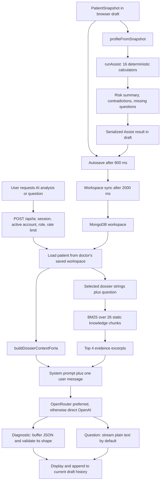

# AI pipeline review — 2026-11-02

Follow-up: implementation work and current verification are recorded in [ai-fixes.md](ai-fixes.md). The findings below describe the pre-fix code.

The highest-value improvements are accurate patient inputs, trustworthy score provenance, and grounded evidence. A larger model will still receive incorrect or incomplete information until those are addressed. This review adds documentation and synthetic, read-only probes; application behavior has not been changed.

Scope: all files in `src/lib/assist`, `src/lib/ia`, and `src/lib/rag`; `/api/ia`; the main AI panel; patient autosave and workspace synchronization; adjacent score, growth-curve, and IVF implementations where they reveal duplication. This is a code review with selected primary-source checks, not validation of every clinical algorithm or guideline.

**How the current system works**



`assist` is deterministic clinical logic, not an LLM. `rag` is lexical retrieval over a source-controlled array, with no embeddings, document ingestion, automatic source updates, or vector database. `ia` builds prompts and calls the configured external model. Stored AI history is displayed/cached but is not sent as conversation history: follow-up questions currently receive the dossier and the new question only. The training ingestion/export code is separate; the reviewed AI route does not learn from it or retrieve its records.

Useful existing foundations: server-side doctor-scoped patient lookup; identity fields omitted from the selected structured export; explicit external-analysis action; diagnostic output buffered before rendering; schema validation; separate deterministic scores; provider/model/prompt metadata. These are worth retaining while improving their guarantees.

**Priority 1: correct patient facts and deterministic results**

1. **AMH unit mismatch and incorrect POSEIDON group branching.** `src/lib/assist/scores-pma.ts:14` reads `amh_normalized_pmol` and compares it with `1.2`, while the KB's criterion is `1.2 ng/mL`. With this project's conversion, that criterion is approximately `8.568 pmol/L`. A synthetic patient with AFC 8 and AMH 0.5 ng/mL is classified `Normal`, confidence `high`. The previous-response branches also select `1a/1b` by age and `2a/2b` by diminished reserve, which does not preserve the published age-defined groups and response-defined subgroups. A boolean previous-poor-response field cannot represent the full subgroup criteria. Normalize units once, use an explicit oocyte-yield input where available, and report incomplete classification when required history is unknown. Check the adjacent `src/lib/pma/ivf-engine.ts` implementation too; sharing its current code unchanged would preserve other classification problems. The [original POSEIDON proposal](https://f1000research.com/articles/5-2911/v1) specifies the reserve threshold in ng/mL and the grouping framework.

2. **Incomplete BPP becomes an emergency result.** `src/lib/assist/scores-obst.ts:317` sums unknown BPP items as zero and treats any non-null item as sufficient availability. With 30 weeks, EFW 900 g, and only a normal NST entered, the result is Stage 4, `critical`, with `EXTRACTION EN URGENCE`. Require the complete intended BPP assessment before using its total; otherwise expose missing inputs and retain any independently supported findings. This bug occurs after the function's FGR gate, so it does not affect every partial BPP in isolation.

3. **Unknown inputs become reassuring findings.** `profile.ts:27` maps absent yes/no answers to `false`. `scores-cross.ts:158` can therefore emit low VTE risk with high confidence from an otherwise empty obstetric dossier. `run.ts:158` removes scores with missing inputs from `executed`; `computeMetaRisk` then summarizes only the remaining scores. Reproduction: `{ id, specialite: 'obst' }` yields `Profil de risque global FAIBLE — Suivi standard`. Use `true | false | null`, retain each applicable score's assessment status, and show assessment coverage separately from observed risk. A missing score must not count as reassuring.

4. **HGPO logic ignores available abnormal values and overstates normality.** In `scores-cross.ts:91`, H1/H2 criteria are nested under the presence of fasting glucose. H1 2.0 g/L with fasting absent returns `Non testé` instead of recognizing that the entered H1 value crosses the function's own threshold. Fasting 0.8 g/L with both post-load values absent returns `HGPO normale`, confidence `high`. Evaluate available criteria independently and distinguish incomplete testing from a complete normal test. The branch for fasting >=7.0 also records overt diabetes in its rationale but returns the same gestational-diabetes label; review that output contract.

5. **Number and gestational-age parsing lose information.** `profile.ts:5` uses `parseFloat`: `1,2` becomes 1, and the application's own generated term `13 SA + 6j` becomes 13 rather than approximately 13.857 weeks. BP parsers can return `NaN`, which `??` will not replace with a valid alternative. Build shared parsers for French decimals, weeks plus days, finite BP components, explicit units, and valid ranges. Do not silently accept arbitrary text prefixes. There are also two different age implementations in `patient-utils.ts` and `build-dossier-context.ts`.

6. **IVF prognosis inputs do not match form values.** `profile.ts:162` passes `i_spermo` (`oui/non`, whether testing was performed) as `sperm_quality`, ignoring `i_spermo_res`. `scores-pma.ts:153` expects English cause codes such as `endo`, `male`, and `unexplained`, whereas the form supplies `endometriose`, `masculine`, and `inexpliquee`. Those adjustments silently become zero. Define a single typed mapping shared with the IVF module; keep unreported results unknown.

7. **Published-model labels exceed what the code demonstrates.** The PE function has no pregnancy or first-trimester eligibility guard. It labels 10% as the ASPRE threshold and also changes the target outcome to PE before 34 weeks. The KB describes 1/100 for preterm PE before 37 weeks. The [FMF-hosted ASPRE research abstract](https://fetalmedicine.org/abstracts/2025/var/pdf/abstracts/2025/07596.pdf) confirms the trial's >=1/100 selection threshold for PE before 37 weeks. This is not a justification to change only the numeric threshold: verify the entire model, its outcome, input normalization, and applicable population first. The miniPIERS KB entry attributes the model to a 2011 Lancet paper and includes laboratory/oxygen predictors, while the [original miniPIERS study](https://journals.plos.org/plosmedicine/article?id=10.1371/journal.pmed.1001589) is Payne et al., 2014 and uses a different predictor set. The implementation also differs from its own KB. Treat these as unresolved clinical-model mismatches and validate against reference cases before presenting them as validated scores.

8. **Uncertainty is overstated statistically and understated in the prompt.** `scores-pma.ts:174` constructs an `IC95` by adding/subtracting eight percentage points. `scores-obst.ts:46` applies a binomial interval with an assumed `n=5000` to an individual modeled posterior. Neither implementation establishes that its displayed interval represents model uncertainty. Use an explicitly named heuristic range only where justified, or omit it until a valid uncertainty method is implemented. `context-block.ts` drops score confidence, disclaimers, missing questions, and model provenance, so the LLM receives the confident-looking conclusion without its qualifications.

9. **Duplicate numerical engines disagree substantially.** With BPD/HC/AC/FL = 80/290/270/60 mm, `assist/norm.ts:207` produces 1,740 g while `growth-curves/hadlock-pfe.ts:8` produces 1,010,741 g. The latter swaps the large linear AC/FL terms relative to the Assist implementation. Both feed related clinical views, so this is a concrete inconsistency requiring reference-formula validation. ROMA, ADNEX, POSEIDON, and other calculations also exist in multiple libraries. Consolidate a clinically verified numerical core, then adapt its output for each UI rather than maintaining independent formulas.

**Priority 2: ensure AI analyzes the intended dossier revision**

10. **The model can receive an older saved dossier than the one displayed.** The main panel calculates scores, patches the draft, and starts its AI request after 200 ms (`hawae-unified-panel.tsx:301`). Draft autosave waits 800 ms (`dossier-workspace.tsx:99`), then remote sync waits 2000 ms (`workspace-sync.tsx:11`). The endpoint reads MongoDB, not the current browser draft, and uses serialized scores without recomputing or checking their input revision. This timing permits a fresh local score next to an AI analysis based on older facts. Make saving/synchronization awaitable, obtain a server revision, and ask the server to analyze that exact authorized revision. Recompute Assist on that snapshot server-side. Merely increasing the timeout is not reliable.

11. **Responses can be associated with another patient or later edits.** `appendIaToDraft` reads whichever draft is active when the response completes (`hawae-unified-panel.tsx:103`). The generation cache key is also calculated after the request (`:334`). There is no matching post-response patient/revision guard, and no unmount cleanup that cancels both request types. Switching dossiers during a request can append the old response to the new active dossier; editing during generation can label the old response with the newer context key. Capture patient ID, request ID, and server revision at dispatch; verify all three before rendering/persisting; abort on patient switch/unmount; write history by explicit patient ID. This finding is from code-path inspection, not a browser race test.

12. **Cache identity includes generated artifacts and excludes important versions.** `build-dossier-context.ts:200` removes three fields but retains `hawaeAssistAt` and serialized score results. Opening the AI panel refreshes that timestamp, changing the cache key without changing clinical facts. The key does not include KB version, engine version, model, prompt version, or analysis-schema version. Build a canonical projection of clinical inputs, hash it on the server, and combine it with the relevant versions. Return this provenance with every response.

13. **The prompt omits available clinical inputs and mislabels a field.** `build-dossier-context.ts:138` exports only a few infertility fields. Important available values such as `i_amh_ngml`, CFA, infertility cause, previous response, PlGF/PAPP-A, uterine Doppler, and several PE/VTE history fields are absent as raw data. Some may be indirectly summarized by saved scores, which are not a substitute for their inputs. `o_ncs` is labeled `Nombre de CPN` at line 134, while the form uses it for previous cesarean sections. Export a normalized, typed clinical projection with units, explicit unknowns, and measurement dates. Keep relevant raw facts next to derived findings. Replace blind 18,000-character tail truncation with a token budget that reserves space for alerts, medications, allergies, and evidence; earlier long narratives can otherwise remove those later sections.

**Priority 3: make retrieval and references dependable**

14. **Retrieval misses common clinical acronyms and can drop the actual question.** `rag-engine.ts:25` removes tokens of two characters or fewer; `PE`, `DV`, and `AO` alone each return zero hits. `authorized-patient-context.ts:27` places the physician's question last and truncates the combined query at 1,500 characters. A long motif/symptom history can eliminate the question. The query also ignores many measurements and positive risk factors. Preserve a clinical abbreviation allowlist, expand curated synonyms (PE/preeclampsie, RCIU/FGR, CFA/AFC), prioritize the question, and add compact concepts from normalized facts and valid score findings. Retrieve separately for independent questions/active problems, then merge and deduplicate results within an evidence budget.

15. **Ranking and evidence selection need one observable implementation.** `search` and `ragSearch` duplicate the entire BM25 scoring procedure. Keyword boosts multiply repeatedly, scores are discarded in the generation path, domain/gestational applicability is unused, and four overlapping snippets can occupy the whole evidence budget. Keep one `rankChunks` function returning stable chunk IDs, scores, matched concepts, and provenance. Deduplicate query terms; bound boosts; add section/diversity selection and soft applicability filters that preserve relevant cross-domain guidance. Evaluate the existing 0.05 cutoff rather than assuming it means clinical relevance. Add an explicit no-evidence result when no sufficiently relevant source is available.

16. **Knowledge entries are summaries without auditable source locations.** `knowledge-base.ts` contains 26 manually authored summaries with organization/year and broad evidence letters, but no URLs/DOIs, source passages/pages, review status/date, jurisdiction, supersession relation, or checksum. `buildRagBlock` calls them official/validated although the code does not establish that validation. Several summaries conflict with executable rules. Store verified source metadata and passage provenance, add a clinical review workflow, and version the corpus. Split combined diagnosis/prevention/treatment summaries by coherent section, preserving enough context and qualifiers. Merge duplicate topics where appropriate. Do not use publication age alone as a relevance or correctness signal.

17. **Citations are accepted without belonging to the supplied evidence.** `clinical-analysis-schema.ts:67` checks strings/year shape only; a completely fabricated citation is accepted by the probe. The route does not retain retrieved hits for checking references. Return `{ context, evidence }`, ask for stable `chunkId` references, validate every top-level and nested reference against that request's evidence, and resolve display titles/links server-side. This proves membership, not whether the excerpt entails the claim; assess claim support separately. `clinicalAnalysisToText` also drops limitations, evidence references, and supporting/limiting facts from the history's text fallback. Preserve those qualifications there, and render nested claim references in the structured UI.

18. **Evidence instructions conflict with the prompt's data boundary.** The RAG block includes `INSTRUCTION RAG` and a training-memory fallback, but the whole combined block is wrapped inside `DOSSIER_CLINIQUE`, whose system policy says embedded instructions are data. Diagnostic instructions say to rely strictly on the dossier. Move evidence policy into the system prompt, with separate serialized patient and evidence data sections. State how to handle unsupported questions and distinguish supplied evidence from general background. Escaping/structured serialization helps preserve boundaries; it is not proof against prompt injection. Identity selection also does not scrub identifiers typed into free-text notes, so the UI's pseudonymization claim should describe that limit accurately.

**Priority 4: improve provider reliability and maintainability**

19. **Valid streaming line endings produce an empty answer.** `openai-chat-stream.ts:29` splits only on `\n\n`. The probe returns `probe` for LF and an empty string for CRLF. The [SSE standard](https://html.spec.whatwg.org/multipage/server-sent-events.html#parsing-an-event-stream) permits CRLF, LF, and CR line endings. Use a proper incremental event parser across arbitrary byte boundaries; handle multi-line event data, provider error events, decoder flushing, completion state, and reader cleanup. Add request timeouts and propagate request/downstream cancellation to the provider fetch. Current cancellation aborts the browser request but does not explicitly cancel the upstream generation. Do not treat a truncated/failed stream as a completed response suitable for caching.

20. **Boundary validation and generation contracts are too permissive.** `/api/ia` casts JSON to `Body`; `null`, numeric `question`, or non-string `patientId` can fail outside the provider error handler. Validate the entire request shape and size before string operations. `parseTemperature` converts a configured zero to 0.3 because it uses `Number(raw) || 0.3`. Use explicit finite-number parsing. Diagnostic requests ask for JSON in prose but send no provider-supported structured-output schema and ignore `finish_reason`, including truncation. Add schema-constrained generation where the configured provider/model supports it, retain runtime validation, handle refusals/truncation distinctly, and consider at most one bounded repair attempt for recoverable formatting failures. The schema currently silently slices lists/text; reject unsupported oversize clinical content or report truncation explicitly rather than silently discarding later red flags.

21. **Failures and coverage are hidden.** `run.ts:154` catches every calculator exception and continues without a diagnostic record. Replace that with per-score `ok / incomplete / not_applicable / error`, retaining missing inputs and a safe error code. In `contradictions.ts`, R08's high-risk PE without left UtA is unreachable from the current PE runner because that runner requires left/right UtA. R04 only checks POSEIDON groups 3/4, while diminished reserve with previous poor response is currently mapped to other groups. Some rules label risk-factor combinations physiologically impossible rather than identifying uncertain inputs. Separate data-validation errors, differing model outputs, and clinical interpretation; review the latter with reference sources. Contradictions should not compensate for incorrect score models.

**Implementation sequence for better results**

1. Fix parsing, units, mappings, BPP completeness, HGPO completeness, score eligibility, and the model/KB discrepancies. Add reference-based numerical and missing-data cases before changing clinically meaningful formulas. Preserve unknowns throughout the pipeline.
2. Introduce an authoritative `ClinicalContext` from a saved patient revision: normalized facts with units/timestamps, assessment coverage, verified derived scores, limitations, and provenance. Compute it once on the server for inference, with the same numerical core available for local previews.
3. Return a structured retrieval result instead of a single string. Improve abbreviation/synonym handling, query allocation, per-problem coverage, source metadata, and citation membership checks. Keep the in-memory BM25 approach while the corpus is small; infrastructure is not its present bottleneck.
4. Consolidate provider HTTP/error handling, add validated requests, bounded generation, timeout/cancellation, compliant streaming, and patient/revision-safe persistence. Ensure the cache key includes context, evidence, prompt, schema, engine, and model versions.
5. Benchmark answer quality and only then compare model configurations or add semantic retrieval. A future BM25-plus-vector retriever could use rank fusion; [MongoDB documents hybrid retrieval and reciprocal rank fusion](https://www.mongodb.com/docs/vector-search/hybrid-search/hybrid-search-overview/). This is an option for a larger corpus with measured semantic misses, not a demonstrated need for the current 26 chunks.

Suggested service boundary, as a design sketch:

```ts
type AnalysisInput = {
  patientId: string;
  expectedRevision: string;
  mode: 'diagnostic' | 'question';
  question?: string;
};

// authorize + load exact saved revision
// -> normalize facts and preserve unknowns
// -> execute verified applicable scores, retain coverage/errors
// -> retrieve scored/versioned evidence for the actual task
// -> construct one budgeted, structured prompt
// -> generate and validate shape/completion/citation membership
// -> persist against captured patient ID + revision, return provenance
```

Centralize calculators incrementally through adapters instead of rewriting every screen at once. Fetch only the authorized patient's data needed for an analysis rather than transferring the entire doctor workspace to each AI request. Avoid importing/indexing the whole KB into a client component merely to display its count; return corpus/version and actual retrieved-source metadata from the server. Add focused lint/type checks and the clinically meaningful regression suite to CI.

**Evaluation that would make improvements measurable**

Use a clinician-reviewed synthetic evaluation set covering obstetrics, gynecology, and infertility; missing vs negative facts; unit equivalents; gestational boundaries; contradictory inputs; multiple active problems; irrelevant questions; fabricated citations; and prompt-like text in patient notes. Keep retrieval and answer evaluation separate.

| Layer | Evidence to collect |
| --- | --- |
| Parsing and scores | Reference outputs, unit invariance, missing-input behavior, applicability, clinically plausible ranges |
| Retrieval | Recall@k / ranking against labeled relevant chunks, abbreviation/synonym cases, task coverage, irrelevant-retrieval rate |
| Generation | Patient-fact fidelity, citation membership and actual support, unsupported-claim rate, red-flag coverage, handling of insufficient information |
| UI/persistence | Patient-switch and edit-during-request races, rejected revision mismatch, synchronized context, correct cache invalidation |
| Operations | Completion/schema failures, cancellation behavior, time to first token, total latency, token usage/cost, model/prompt/KB versions |

Do not choose a model or retriever from a few impressive examples. Use the same fixed inputs/evidence across candidates, track regressions by clinical domain, and have clinical reviewers assess unsupported advice. Current provider metadata is a useful start but does not demonstrate answer quality.

**Verification performed and limits**

Run `node docs/ai-audit-probes.mjs` with Node >=22.15. It imports the actual pure TypeScript modules through a small in-memory loader and reports 18 groups of current behavior. All patient data is synthetic. Fetch is mocked for SSE cases; no provider, database, or patient-data requests are made. The loader only desugars one error constructor's TypeScript parameter properties in memory for Node's type stripper; the SSE parser itself is unmodified.

The probe completed on Node v26.13.0. Observed results include the AMH misclassification, partial-BPP critical result, incomplete HGPO errors, empty-dossier low-risk summary, inappropriate gynecologic missing questions, out-of-population PE result, gestational/decimal parsing loss, divergent Hadlock values, missing prompt fields, generated-timestamp cache invalidation, fabricated-citation acceptance, and LF/CRLF streaming discrepancy. These are characterization observations, not passing clinical validation tests.

Full application build, lint, TypeScript checking, browser integration, authenticated authorization tests, and live model evaluation were not run: project dependencies are not installed in this checkout. Source-level synchronization/race findings need integration tests when that environment is available. No conclusion here certifies clinical validity or readiness for patient care; the identified clinical-model mismatches require source-based review.
