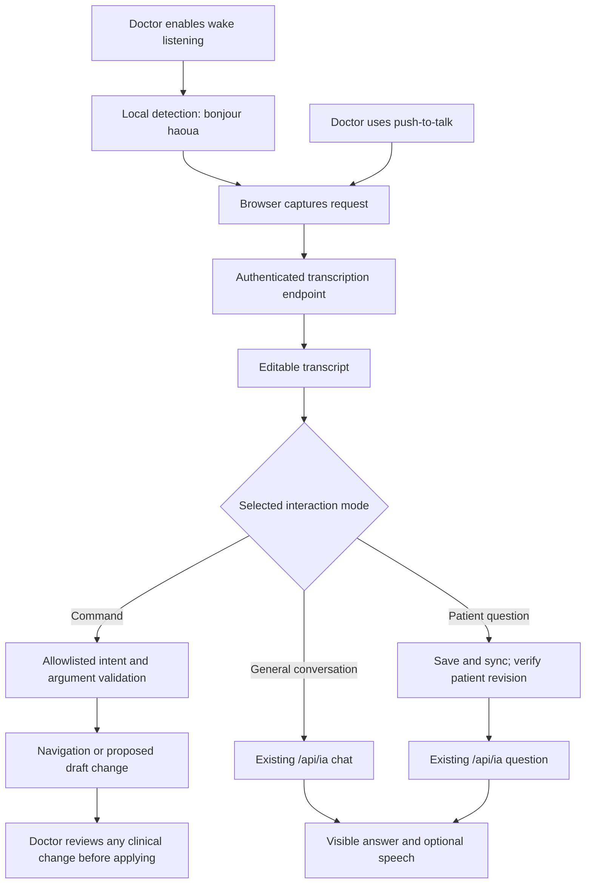

# Voice commands and doctor–Hawae voice chat

Analysis date: 2026-11-16. This document records the original implementation proposal. The browser-based first release is now implemented; see [current behavior and setup](voice-assistant.md). Server speech endpoints and a custom acoustic wake detector below remain future options. The release uses explicitly selected local/browser speech recognition with transcript-based wake activation, and browser speech synthesis.

## Recommendation

Start with push-to-talk voice using a transcription → existing Hawae AI → speech pipeline. Add a small, explicit command vocabulary alongside conversational questions. This preserves the configured reasoning provider, clinical retrieval, deterministic scores, and dossier revision checks. Add continuous conversation with interruption support as a later stage if the measured turn latency is insufficient.

Requirements for the first release: the doctor speaks directly to Hawae, French is the default, and the wake phrase is **“bonjour haoua”**. The doctor explicitly enables microphone listening before wake detection starts. Push-to-talk remains available. Recording a doctor–patient consultation, speaker identification, and ambient note generation are separate features.

## Wake phrase: “bonjour haoua”

Provide an **Activer l’écoute** control. After microphone permission is granted, show **En attente de « bonjour haoua »** with a persistent microphone indicator and an **Arrêter l’écoute** control. The wake phrase activates the assistant within the selected Discussion, Dossier, or Commande mode; it does not change patient context or authorize a clinical edit.

Target flow:

1. The doctor enables listening while the application is in the foreground.
2. A local wake detector listens specifically for **“bonjour haoua”**.
3. Detection opens the assistant, gives a short visual/audio acknowledgement, and captures the next utterance. Support a single utterance such as **“bonjour haoua, ouvre l’agenda”** by retaining a short in-memory audio buffer and the words after the phrase.
4. Transcribe the request, remove the wake prefix, and route it through the selected mode. If only the wake phrase was spoken, wait briefly for the request, then return to waiting on silence. Do not send an empty question to `/api/ia`.
5. After the answer or command finishes, return to wake listening only if the doctor still has listening enabled. Pause detection during assistant playback to avoid self-activation.

Prefer on-device keyword detection so waiting for the wake phrase does not continuously upload consultation audio. A custom French wake model/runtime must be selected and tested with the pronunciation of “haoua”; this repository currently has neither. Verify browser support, model licensing, CPU usage and false activations before choosing the runtime. Do not silently substitute continuous cloud transcription. If a supported local detector is unavailable, explain that wake activation is unavailable and offer push-to-talk.

Keep the canonical phrase exactly **“bonjour haoua”**. For transcript-prefix handling normalize case, whitespace and punctuation and match whole tokens. Do not broaden detection to “bonjour” alone. Any recognition aliases for “haoua” must be explicitly evaluated; transcript matching by itself is not an always-listening acoustic wake detector.

Bound the in-memory pre-roll and request window, discard waiting audio locally, debounce repeated detections, and stop listening on logout, user/patient switch, explicit disable, or page backgrounding. Re-enabling after these events requires an explicit user action. Wake detection never substitutes for session authorization or the clinical-change review step.

## Existing integration points

| Source | Current behavior | Voice implication |
| --- | --- | --- |
| `src/components/assist/quick-ai-bubble.tsx` | General text chat, streaming responses, bounded completed-turn history, cancellation | Add microphone, transcript preview, and optional spoken replies here first |
| `src/app/layout.tsx` | Mounts quick chat globally with access state | Keep microphone disabled for unauthenticated/restricted access |
| `src/components/ia/hawae-unified-panel.tsx` | Dossier analysis and patient-specific follow-up; stores AI exchanges with provenance | Add patient voice questions through the existing follow-up path |
| `src/app/api/ia/route.ts` | Session, active account, doctor role, rate limiting, RAG, provider selection and learning integration | Reuse for reasoning after transcription |
| `src/lib/ia/provider-config.ts` | OpenRouter first, otherwise direct OpenAI; text chat-completions configuration | Configure speech independently; text credentials do not establish speech support |
| `src/lib/ia/patient-request-client.ts` | Saves and pushes the draft before AI requests; captures revision and checks current patient | Reuse for patient voice requests and add equivalent playback guards |
| `src/lib/ia/authorized-patient-context.ts` | Loads the authorized doctor's saved patient and checks clinical revision | Keep this server-side boundary for voice |
| `src/lib/ia/request-schema.ts` | `chat` excludes patient context; only `chat` accepts conversation history | Patient voice follow-ups need an explicit history design for conversational references |
| `src/components/dossier/dossier-workspace.tsx` | Owns active tab, patient draft, modal state and 800 ms autosave | Dispatch dossier commands through its callbacks |
| `src/stores/hawae-store.ts` | `patchDraft` changes the draft; `saveDraft` updates local persisted workspace | Applying a voice patch can trigger autosave, so stage proposals outside the draft |
| `src/lib/storage/workspace-sync-client.ts` | Pushes workspace changes to the server | Distinguish a local save from confirmed server synchronization |
| `next.config.ts` | Sends `Permissions-Policy: camera=(), microphone=(), geolocation=()` | Microphone capture is currently blocked; permit `microphone=(self)` |

No speech recognition, recording, synthesized playback, or voice command dispatcher was found in `src`.

## Interaction flow

Use clearly visible modes: **Discussion**, **Dossier**, and **Commande**. Do not guess whether an ordinary clinical sentence is an instruction to modify the application. The global discussion remains dossier-free; patient context is explicitly selected in the dossier panel.

For the MVP, the doctor records a short utterance, reviews the transcription, and sends it. A subsequent conversational mode can automatically send finalized utterances after the doctor enables it. Provide transcript editing, stop recording, cancel generation, stop speaking, retry, and text input throughout.

## Voice commands

Begin with deterministic parsing of a limited French vocabulary. Return a typed intent, validated arguments, or an unsupported/ambiguous result. Execute through application callbacks rather than DOM clicks or generated JavaScript.

| Example | Execution |
| --- | --- |
| “Ouvre l'agenda” | Navigate to `/agenda` |
| “Affiche les scores” | Select the `scores` dossier tab when a dossier is open |
| “Ouvre Hawae” | Open the relevant assistant panel |
| “Arrête de parler” | Cancel playback; always keep a visible stop control |
| “Ajoute aux symptômes : douleurs pelviennes depuis trois jours” | Show an append preview for `symptomes`; apply only after review |
| “Résume le dossier” | Run a patient question against the authorized saved revision |

Use a field allowlist for future dictation: start with narrative fields such as `motif`, `symptomes`, and `atcdMed`. Structured measurements, units, dates, negation and prescriptions need separate validation. Do not expose arbitrary `PatientSnapshot` keys to a model-generated patch. An AI intent classifier can be added later, but its output must pass the same schema and execution checks.

Record pending changes as `{patientId, currentUserId, baseRevision, operation, field, value}` outside Zustand's persisted patient draft. Recheck identity and revision on apply; discard after patient/user changes. Show the old and proposed value, with explicit append/replace semantics. Because dossier autosave runs automatically, calling `patchDraft` is the actual commit point.

Start without voice deletion, prescribing, patient-name matching, bulk edits, or exports. These expand ambiguity and require individual interaction designs. A spoken “yes” alone must not commit a pending clinical change in the first release.

## Proposed implementation

These paths are proposed additions, not existing modules.

| File | Responsibility |
| --- | --- |
| `src/lib/voice/provider-config.ts` | Resolve independently configured transcription and speech providers/models |
| `src/app/api/voice/transcribe/route.ts` | Authenticate and authorize, enforce bounded uploads, call transcription provider, return text |
| `src/app/api/voice/speak/route.ts` | Authenticate and authorize, bound text length, generate audio, use no-store responses |
| `src/lib/voice/commands.ts` | Pure intent parsing and argument validation |
| `src/lib/voice/wake-phrase.ts` | Canonical “bonjour haoua” phrase, whole-token transcript-prefix handling and activation debounce |
| `src/components/voice/use-wake-word.ts` | Local wake detector lifecycle, bounded pre-roll, foreground/access guards and activation events |
| `src/lib/voice/types.ts` | Intent union, voice state and pending clinical edit types |
| `src/components/voice/use-voice-session.ts` | Capture, cancellation, object URLs, audio playback and cleanup |
| `src/components/voice/voice-controls.tsx` | Accessible recording controls, transcript editing and playback controls |
| `src/components/voice/voice-provider.tsx` | Coordinate one recording/playback owner across global chat and dossier panels |

Use browser `getUserMedia` and `MediaRecorder`, selecting a supported audio MIME type at runtime. Bound utterance duration and upload size both in the client and on the server; account for the deployment platform's request-body limit. Use timeouts and cancellation for upstream calls. Verify format/content rather than trusting client MIME metadata. Keep permanent provider keys on the server.

Suggested configuration: `VOICE_ENABLED`, `VOICE_PROVIDER`, `VOICE_API_KEY`, `VOICE_TRANSCRIBE_MODEL`, `VOICE_SPEAK_MODEL`, `VOICE_LANGUAGE=fr`, `VOICE_MAX_SECONDS`, and `VOICE_MAX_UPLOAD_BYTES`. Final defaults depend on the chosen provider and deployment limits. OpenAI is one supported implementation option; using it for speech does not require replacing OpenRouter for reasoning.

State machine: `disabled → wake-listening → recording → transcribing → reviewing → thinking → speaking → wake-listening`, with push-to-talk entry, silence timeout, error and cancellation transitions. Return to `disabled` when listening is stopped or access/context changes. Capture a session/run ID at each async operation and reject results from superseded runs. In the first version pause recording and wake detection during playback to prevent Hawae hearing its own output. Stop microphone tracks, abort fetches, revoke object URLs and stop audio on close, unmount, logout, user/patient switch and page backgrounding. Recheck the active patient/revision before playback as well as before persisting an answer.

Read back only completed answers initially; do not speak provisional diagnostic JSON, partial failures, or incomplete text chunks. Use the same completed text shown to the doctor as the TTS input. For long clinical output offer read-aloud on demand; a shorter spoken summary would be a separate generated artifact requiring traceability.

## Patient conversation history

The current patient `question` mode sends the question plus current dossier, not previous conversational turns. Simply adding a microphone would not resolve “Why?” or “What about the second option?”.

First milestone can use self-contained patient questions and make that limit visible. For full patient voice chat, extend the request schema with a bounded patient-conversation mode. Prefer server-loaded complete exchanges scoped to the authenticated doctor, patient, and matching clinical revision. Exclude cancelled/failed exchanges; treat previous assistant text as conversation, not verified patient facts or medical evidence. Clear conversational context when the patient or clinical revision changes. Keep general `chat` unable to attach a dossier. Update request validation, prompt construction and API regression tests together.

## Access, data and failure handling

Mirror `/api/ia` session, active-account and doctor-role checks in both speech routes; do not rely on page middleware. Add per-account rate and concurrency limits for audio, request-origin protections for cookie-authenticated mutations, and no-store response headers. A deployment-wide quota needs shared storage; the existing in-memory limiter alone is per process.

Explain when audio is sent to a speech provider and label generated speech as AI output. Do not put raw recordings into patient documents, localStorage, training ingestion or ordinary logs. Release app-held audio after use; provider retention is a separate configuration to verify. Voice does not create new learning consent. Existing consent-gated AI exchange capture remains applicable to generated patient answers.

Handle denied/revoked microphone access, missing devices, unsupported recording formats, silence, oversized utterances, provider failure, expired sessions, and playback refusal with actionable messages and a text fallback. Request microphone access only after user action, over HTTPS (localhost during development).

Browser-native `SpeechRecognition` should be an optional enhancement: support is limited and some implementations send audio to an external recognition service. Do not present it as guaranteed offline or private.

## Delivery sequence and validation

1. Add capture/transcription and transcript review to general quick chat; update the microphone policy and environment example. Reuse existing chat requests.
   Include “bonjour haoua” activation after selecting and validating a local wake detector, with explicit enable/disable controls and push-to-talk fallback.
2. Add optional spoken responses and coordinated cancellation. Verify that errors/cancelled answers never play.
3. Add patient voice questions with existing save/sync/revision checks, then implement bounded patient conversation history.
4. Add navigation/tab commands and staged narrative dictation through existing callbacks.
5. Measure recording-to-transcript, end-of-turn-to-answer, first-audio latency, transcription corrections and command errors. Evaluate realtime only against measured needs.

Automated tests should cover command ambiguity and negation, unauthorized speech access, upload/text bounds, provider errors, cross-patient/user cancellation, revision conflicts, stale pending edits, and patient-history isolation. Use synthetic cases, including French clinical vocabulary, decimal values, gestational ages, units and negated symptoms. Manual browser/device checks should include the supported desktop browsers and iOS Safari/Android Chrome, microphone permissions, backgrounding, echo, playback restrictions and cleanup. Rerun the existing AI regression suite after schema or prompt changes.

Wake-specific validation: the exact phrase and phrase-plus-command activate correctly; “bonjour” alone and unrelated consultation speech do not; repeated detections activate once; silence creates no AI request; playback does not self-trigger; disabled/background states do not listen; waiting audio is not uploaded. Measure false activations and missed detections with representative French speakers, accents, room noise and microphone distances before release.

This review is source-based. Dependencies are absent in this checkout, so build, API tests and microphone behavior have not been executed.

## Realtime alternative

For natural interruption and continuous turn taking, a WebRTC realtime session is a later option. The server authenticates the doctor and creates a short-lived client credential; the browser never receives a permanent API key. Route clinical tools through authenticated server handlers that repeat patient ownership and revision checks. A realtime speech model must call the existing clinical pipeline for patient reasoning if behavior is to stay consistent; sending the dossier directly to a new speech model would create a second reasoning path with different prompts, retrieval, validation and audit behavior.

## Primary references

- [OpenAI audio and voice overview](https://developers.openai.com/api/docs/guides/audio)
- [OpenAI file transcription](https://developers.openai.com/api/docs/guides/speech-to-text)
- [OpenAI text to speech](https://developers.openai.com/api/docs/guides/text-to-speech)
- [OpenAI realtime API](https://developers.openai.com/api/docs/guides/realtime)
- [MDN microphone Permissions-Policy](https://developer.mozilla.org/en-US/docs/Web/HTTP/Reference/Headers/Permissions-Policy/microphone)
- [MDN getUserMedia](https://developer.mozilla.org/en-US/docs/Web/API/MediaDevices/getUserMedia)
- [MDN MediaRecorder format detection](https://developer.mozilla.org/en-US/docs/Web/API/MediaRecorder/isTypeSupported_static)
- [MDN SpeechRecognition compatibility and processing](https://developer.mozilla.org/en-US/docs/Web/API/SpeechRecognition)
